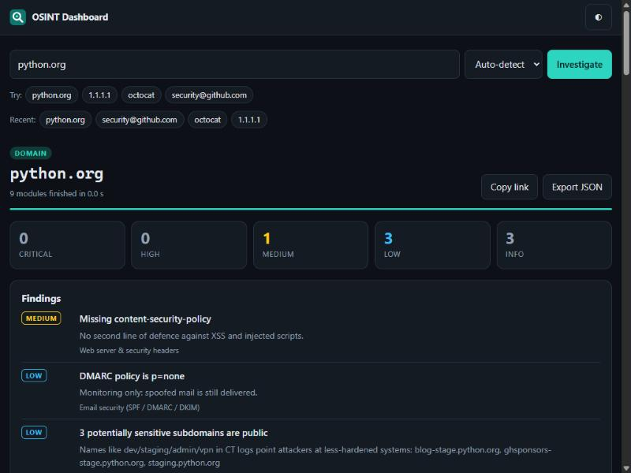

# OSINT Dashboard

A web dashboard for **passive reconnaissance**. You type a domain, IP address, email address or username, and it queries a dozen public sources in parallel. Results stream into the page as each source answers, and the security-relevant findings (spoofable email domain, exposed RDP, newly registered domain, missing HSTS...) are collected into one list ranked by severity.



It's built with **FastAPI**, **httpx** (async) and **dnspython**, with a dependency-free vanilla JS frontend. It works with **no API keys**. Optional keys enable AbuseIPDB, VirusTotal and Have I Been Pwned.

## What it looks up

| Target | Module | Source | Flags things like |
|---|---|---|---|
| Domain | DNS records | DNS (A, AAAA, MX, NS, TXT, CAA, SOA) | no CAA record |
| Domain, email | Email security | SPF, DMARC, 15 common DKIM selectors | no SPF / `+all` / `?all`, >10 SPF lookups, no DMARC or `p=none` → **spoofable** |
| Domain | Registration | RDAP (the modern WHOIS) | registered < 30 days ago, expiring soon, no transfer lock |
| Domain | Subdomains | Certificate Transparency (crt.sh) | exposed `dev`, `staging`, `vpn`, `jenkins`... hosts |
| Domain | TLS certificate | direct TLS handshake | untrusted cert, expiring < 14 days, TLS 1.0/1.1 |
| Domain | Web security headers | HTTPS + HTTP request | missing HSTS/CSP/etc., version disclosure, insecure cookies, no HTTPS redirect. Gives an A-F grade. |
| Domain | Hosting | DNS + ipinfo | |
| Domain | Web history | Wayback Machine | |
| IP | Location & network | ipinfo | |
| IP | Network owner | RDAP | (abuse contact for reporting) |
| IP | Reverse DNS | PTR + forward confirmation | PTR not forward-confirmed |
| IP | Open ports & CVEs | Shodan InternetDB (free) | RDP/SMB/Redis/DBs exposed, known CVEs, `compromised`/`malware` tags |
| IP | Abuse reports | AbuseIPDB 🔑 | high abuse confidence, Tor exit |
| IP, domain | Reputation | VirusTotal 🔑 | flagged by AV / blocklist engines |
| Email | Email domain | DNS MX | disposable provider, no MX. Also detects Google/Microsoft 365/Proofpoint... |
| Email | Public profile | Gravatar | profile and linked accounts tied to the address |
| Email | Data breaches | Have I Been Pwned 🔑 | breaches, especially ones that leaked passwords |
| Username | Accounts | GitHub, GitLab, Codeberg, Docker Hub, DEV, Hacker News, Keybase, Mastodon, Chess.com, Lichess | (reports "could not check" separately from "not found") |

🔑 = needs a free or paid API key in `.env`. Without one, the module shows as *skipped*.

## Run it

```bash
cd projects/OSINT-dashboard
python -m venv .venv
.venv\Scripts\activate            # Windows   (Linux/macOS: source .venv/bin/activate)
pip install -r requirements.txt
cp .env.example .env              # optional: add API keys
uvicorn app.main:app --reload
```

Then open <http://127.0.0.1:8000>. You can link straight to a search, e.g. `http://127.0.0.1:8000/?q=python.org`.

**Docker:**

```bash
docker build -t osint-dashboard .
docker run --rm -p 8000:8000 --env-file .env osint-dashboard
```

## API

The dashboard is a thin client over a JSON API, so you can script it:

| Endpoint | Description |
|---|---|
| `GET /api/lookup?q=TARGET[&type=domain\|ip\|email\|username][&modules=a,b]` | runs everything and returns one JSON document ([example](docs/example-1.1.1.1.json)) |
| `GET /api/stream?q=TARGET...` | the same lookup as **Server-Sent Events**: `start`, then one `module` event per source as it finishes, then `done` |
| `GET /api/modules` | available modules and whether their API key is configured |
| `GET /docs` | interactive OpenAPI docs (FastAPI) |

```bash
curl -s "http://127.0.0.1:8000/api/lookup?q=example.com&modules=email_security,whois" | jq .findings
```

## Design notes

```
browser ──fetch /api/stream──▶ FastAPI ──▶ parse_target() ──▶ run_all(): one asyncio task per module
   ▲                                                              │  (per-module timeout, errors contained,
   └──────── SSE "module" events as each task completes ◀─────────┘   10-minute result cache)
```

- **One module = one async function.** Each one is registered with `@module(id, title, kinds, key=...)` and returns a `Result(summary, data, findings, links)`. Adding a source means writing one function. The frontend renders `data` generically, so it needs no UI changes.
- **Failures stay local.** Timeouts, HTTP errors and bugs in one module show up as that card's `error` status. The rest of the lookup carries on. Errors are not cached, so a retry can succeed.
- **Streaming.** crt.sh can take 10+ seconds, so results are pushed as they arrive instead of waiting for the slowest source. The client reads the stream with `fetch` (not `EventSource`) so it can show the API's error messages.

### Security of the tool itself

An OSINT tool takes arbitrary input and makes outbound requests, so it's a natural **SSRF** target. These defences are built in:

- **SSRF guard** ([`app/netguard.py`](app/netguard.py)). The two modules that connect to the target (TLS and HTTP headers) resolve the hostname first. They refuse to connect if *any* address is loopback, private, link-local (e.g. the cloud metadata service `169.254.169.254`), CGNAT, multicast or reserved. Redirects are followed manually so **every hop** is checked again, and the TLS check connects to the vetted IP itself. Private IPs typed directly are rejected up front.
- **Untrusted data stays text.** DNS TXT records, HTTP headers and profile bios can contain HTML. The frontend only inserts data with `textContent` (no `innerHTML`), and a strict **Content-Security-Policy** (`script-src 'self'`, no inline code) acts as a second layer.
- **Rate limiting** per client (default 20 lookups/minute) and input length/format validation.
- The app sends its own security headers (CSP, `X-Frame-Options: DENY`, `nosniff`, `Referrer-Policy: no-referrer`), so it gets the A grade it checks other sites for.
- The Docker image runs as an unprivileged user, and API keys come from the environment and are never sent to the browser.

**Known limitation:** a DNS-rebinding attacker could change a hostname's answer between the check and the HTTP request in the headers module. The TLS module isn't affected because it connects to the checked IP. Fixing it fully would mean pinning the resolved IP in the HTTP transport.

## Tests

```bash
pip install -r requirements-dev.txt
pytest
```

The 77 tests run **fully offline**: DNS goes through a fake resolver, and HTTP goes through `httpx.MockTransport` with recorded-style responses. They cover target detection (URLs, IDN domains, IPv6, `@handles`), the SSRF guard (loopback, metadata IP, IPv4-mapped IPv6, redirect to an internal host), SPF/DMARC parsing edge cases, every module's parsing and severity logic, and the API (SSE event order, 400/429 responses, security headers).

## Ethics

Everything here is passive, public-source intelligence, the same data anyone can query by hand. The only direct contact with the target is one ordinary TLS handshake and one or two HTTP GETs to its home page. Use it on assets you own or are authorised to assess. Treat username matches as leads, not proof: different people can share a username.
